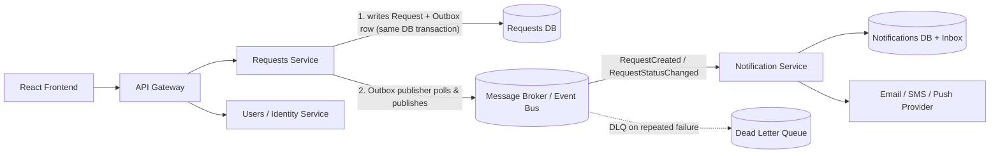

# Architecture – Migration to Microservices (Part B)

## 1. Context

The current system is a single ASP.NET Core Web API (`Requests.Api`) backed by one
database, following a clean/layered architecture (`Domain` / `Application` /
`Infrastructure` / `Api`). As the system grows, we want to move to microservices to
scale teams and load independently, deploy more often with less risk, and isolate
failures.

## 2. Proposed Service Decomposition

| Service | Responsibility | Data owned |
|---|---|---|
| **Requests Service** | CRUD + search/filter/sort of Requests; enforces ownership/admin permissions | Requests DB (its own schema) |
| **Users/Identity Service** | Authentication, user profile, roles (Admin vs regular), owns "who is admin" | Users DB |
| **Notification Service** | Sends notifications (email/SMS/push) when a Request is created or its status changes | Notification/delivery log DB, Outbox/Inbox tables |
| **API Gateway** (e.g. YARP / Azure API Management / Ocelot) | Single entry point for the Frontend; routing, auth token validation, rate limiting | none (stateless) |
| *(optional, future)* **Audit/Reporting Service** | Long-term analytics over request history | Read-optimized store / data warehouse |

Each service:
- Has its own datastore (**database-per-service**) - no service reaches into another
  service's tables directly.
- Is independently deployable and independently scalable (e.g. Requests Service can
  scale to many replicas for read-heavy search traffic, while Notification Service
  scales based on message volume).
- Exposes a versioned HTTP/gRPC API for synchronous calls, and publishes/consumes
  events for asynchronous integration.

## 3. Benefits of This Architecture

- **Independent scaling:** the Requests search endpoint (read-heavy, potentially
  millions of rows) can scale horizontally without needing to scale Notification
  infrastructure, and vice versa (e.g. bursts of notifications don't compete for the
  same CPU/DB connections as search).
- **Independent deployability:** teams can ship changes to notifications (e.g. add
  SMS provider) without redeploying or risking the Requests API.
- **Fault isolation:** if the Notification provider is down, Requests Service keeps
  working - creating/updating requests is not blocked by notification delivery.
- **Technology fit per service:** e.g. Notification Service could use a different
  language/stack optimized for I/O-bound fan-out, without affecting the rest.
- **Clear ownership boundaries:** each team owns a service + its data model end to
  end, reducing cross-team coordination overhead.

**Tradeoffs to be aware of (asked in the interview, most likely):** operational
complexity (more deployables, more monitoring), distributed transactions become
eventual consistency, network calls replace in-process calls (latency, partial
failure handling), and cross-service debugging requires distributed tracing
(correlation IDs, e.g. OpenTelemetry).

## 4. Reliable Notification Delivery (the required scenario)

**Problem:** When a Request is created or its Status changes, a Notification must be
sent to the relevant user. The Notification Service (or its downstream email/SMS
provider) can be temporarily unavailable. We must not lose the notification, and we
must not double-charge/double-send excessively either.

**Solution: Transactional Outbox + reliable message broker + idempotent consumer.**

1. **Write-side (Requests Service):** When a Request is created or its status
   changes, the service writes two things **in the same database transaction**:
   - the domain change itself (the `Request` row), and
   - a row in an `OutboxMessages` table (`Id`, `Type` = `RequestCreated` /
     `RequestStatusChanged`, `Payload` (JSON), `OccurredAt`, `ProcessedAt` = null).

   Because both writes happen in one local DB transaction, it is **impossible** for
   the Request to change without the event being recorded, and vice versa - this
   avoids the classic "dual write" problem (DB commit succeeds, message publish
   fails, event is lost).

2. **Outbox publisher (background worker):** A separate background process (in the
   Requests Service, or a small dedicated relay) polls unprocessed rows from
   `OutboxMessages` and publishes them to a **message broker** (e.g. RabbitMQ, Azure
   Service Bus, Kafka). After a successful publish, it marks the row as processed
   (or deletes it). If the broker is briefly unavailable, the publisher simply
   retries later - nothing is lost because the source of truth is the DB table, not
   an in-memory queue.

3. **Message broker persistence:** The broker itself persists messages until they
   are acknowledged by a consumer, and supports **retry with backoff** plus a
   **Dead Letter Queue (DLQ)** for messages that repeatedly fail to be processed
   (e.g. malformed payload, or Notification Service down for a long time). This
   decouples the producer from the consumer's availability entirely.

4. **Consumer side (Notification Service):** Subscribes to the events and delivers
   at **at-least-once** semantics (the broker may redeliver a message, e.g. after a
   crash before acknowledging). To handle duplicate deliveries safely, the consumer
   keeps an `Inbox` table keyed by message id and checks/records "already processed"
   before sending - i.e. **idempotent consumption**. If the downstream email/SMS
   provider is unavailable when a message is picked up, the consumer does **not**
   acknowledge the message; the broker will redeliver it (with backoff) until it
   succeeds or it's moved to the DLQ after N attempts, where it can be inspected and
   retried manually/alerted on.

5. **Observability:** every message carries a correlation id so that "Request X
   changed status" can be traced end-to-end into "Notification Y was sent for
   Request X", enabling debugging of delayed/missing notifications.

This design guarantees: the notification **will eventually be sent** once the
Notification Service/provider recovers, it will **not be silently lost** even if
several components are down simultaneously, and duplicate delivery from at-least-once
semantics is made safe by consumer-side idempotency - without requiring a synchronous,
tightly-coupled call from Requests Service directly to Notification Service.
